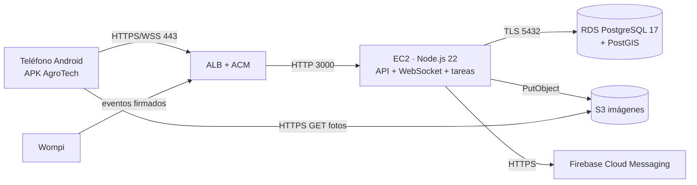

# Runbook de producción · AGRO-16

Entorno de producción de AgroTech en AWS, según el **diagrama de despliegue** (Entrega 3, `AgroTech_07_Despliegue`).

## 1. Arquitectura desplegada

| Capa (Tier-3) | Recurso AWS | Configuración | Archivo |
|---|---|---|---|
| Entrada | Application Load Balancer | HTTPS/WSS :443 (ACM, TLS 1.2–1.3), :80 → 301 a HTTPS, inactividad 120 s (WebSocket) | `infra/agrotech.yaml` |
| Aplicación | EC2 t3.small · Ubuntu 24.04 | Node.js 22, systemd (`agrotech-api`), puerto 3000 solo desde el ALB, IMDSv2, sin SSH (Session Manager) | `infra/servidor/*` |
| Datos | RDS PostgreSQL 17 + PostGIS · db.t3.micro | Subred privada, TLS obligatorio (`rds.force_ssl`), cifrado, copias diarias 7 días, protección contra borrado | `infra/agrotech.yaml` |
| Archivos | S3 `agrotech-imagenes-<entorno>-<cuenta>` | Cifrado; lectura pública **solo** de `productos/*`; escritura solo con el rol de EC2 | `api/src/almacenamiento/fotos-s3.js` |
| Secretos | SSM Parameter Store + Secrets Manager | `/agrotech/<entorno>/*` (SecureString) y `/agrotech/<entorno>/rds` | `infra/servidor/cargar-entorno.sh` |
| Monitoreo | CloudWatch + SNS | Alarmas: servidor no sano, 5xx, p95 > 1 s, espacio y CPU de RDS | `infra/agrotech.yaml` |
| Entrega | GitHub Actions (OIDC) + SSM Run Command | Etiqueta `v*` → pruebas → paquete → `desplegar.sh` → prueba de humo | `.github/workflows/desplegar.yml` |



## 2. Requisitos previos

| # | Requisito | Cómo |
|---|---|---|
| 1 | Cuenta de AWS (créditos de AWS Academy o capa gratuita) y AWS CLI v2 configurada | `aws sts get-caller-identity` |
| 2 | Dominio para la API (p. ej. `api.agrotech.co`) | Registrador o Route 53 |
| 3 | Certificado ACM en `us-east-1` validado por DNS | `aws acm request-certificate --domain-name api.agrotech.co --validation-method DNS` |
| 4 | Llaves de Wompi (sandbox para el piloto, producción al salir) | comercios.wompi.co → Desarrolladores |
| 5 | Cuenta de servicio de Firebase (FCM HTTP v1) | Consola de Firebase → Cuentas de servicio |

## 3. Crear la infraestructura (una sola vez)

```bash
aws cloudformation validate-template --template-body file://infra/agrotech.yaml
aws cloudformation deploy \
  --stack-name agrotech-produccion \
  --template-file infra/agrotech.yaml \
  --capabilities CAPABILITY_IAM \
  --parameter-overrides \
      Entorno=produccion \
      CertificadoArn=arn:aws:acm:us-east-1:<cuenta>:certificate/<id> \
      CorreoAlertas=equipo@agrotech.co \
      RepositorioGitHub=<owner>/agrotech
aws cloudformation describe-stacks --stack-name agrotech-produccion --query 'Stacks[0].Outputs' --output table
```

- Duración aproximada: 15–20 min (RDS es lo más lento).
- Confirmar la suscripción de correo de las alarmas (SNS envía un enlace).
- DNS: registro **CNAME** `api.agrotech.co` → salida `UrlBalanceador`.

## 4. Cargar la configuración secreta (SSM)

```bash
P=/agrotech/produccion
aws ssm put-parameter --type SecureString --name $P/JWT_SECRETO \
  --value "$(node -e "console.log(require('crypto').randomBytes(48).toString('base64url'))")"
aws ssm put-parameter --type SecureString --name $P/WOMPI_LLAVE_PUBLICA      --value pub_prod_xxx
aws ssm put-parameter --type SecureString --name $P/WOMPI_SECRETO_INTEGRIDAD --value prod_integrity_xxx
aws ssm put-parameter --type SecureString --name $P/WOMPI_SECRETO_EVENTOS    --value prod_events_xxx
aws ssm put-parameter --type String       --name $P/WOMPI_URL_RETORNO        --value https://api.agrotech.co/api/v1/pagos/retorno
aws ssm put-parameter --type String       --name $P/FOTOS_URL_BASE           --value https://<BucketImagenes>.s3.us-east-1.amazonaws.com
aws ssm put-parameter --type SecureString --name $P/FCM_CREDENCIALES_JSON    --value file://fcm-cuenta-servicio.json
```

| Parámetro | Obligatorio | Nota |
|---|---|---|
| `JWT_SECRETO` | Sí | ≥ 32 caracteres. Cambiarlo cierra todas las sesiones. |
| `WOMPI_*` | Para CU-22 | Con el entorno `pruebas` se usa el sandbox (`WOMPI_AMBIENTE=test`). |
| `FCM_CREDENCIALES_JSON` | Para push | Sin él la API funciona y los avisos llegan solo por WebSocket. |
| `HORAS_CANCELACION`, `BCRYPT_COSTO` | No | Por defecto 48 h y 12. |

- La contraseña de RDS la genera la plantilla en Secrets Manager; nadie la escribe ni la ve.
- En Wompi (panel de comercios) registrar la URL de eventos: `https://api.agrotech.co/api/v1/pagos/wompi/eventos`.

## 5. Desplegar una versión

1. En GitHub → Settings → Environments → **produccion**: reglas de aprobación y variables `AWS_REGION`, `AWS_ROL_DESPLIEGUE` (salida `RolDespliegueArn`), `ID_SERVIDOR`, `BUCKET_DESPLIEGUES`, `API_URL`.
2. Publicar la versión desde `main`:
   ```bash
   git tag -a v1.0.0 -m "AgroTech MVP" && git push origin v1.0.0
   ```
3. El flujo `Desplegar API` ejecuta: pruebas (lint + 163 pruebas) → `git archive` de `api/ db/ infra/` → S3 → `desplegar.sh` por SSM → prueba de humo (`/salud` = `ok` y migración `005`).

`desplegar.sh` en el servidor:

| Paso | Acción | Si falla |
|---|---|---|
| 1 | Descarga y descomprime en `/srv/agrotech/versiones/<v>` (propiedad de root) | Se detiene; la versión activa no cambia |
| 2 | `npm ci --omit=dev` como usuario `agrotech` | Se detiene |
| 3 | `cargar-entorno.sh` → `/etc/agrotech/api.env` (640) | Se detiene |
| 4 | Migraciones (`node src/db/migrate.js`, con candado) | Se detiene; la versión activa sigue |
| 5 | Cambia el enlace `actual` y reinicia `agrotech-api` | — |
| 6 | Espera `/salud` = 200 hasta 60 s | **Revierte** al enlace anterior y termina con error |

## 6. Operación

| Tarea | Comando |
|---|---|
| Entrar al servidor (sin SSH) | `aws ssm start-session --target <IdServidor>` |
| Estado y registros | `systemctl status agrotech-api` · `journalctl -u agrotech-api -f` |
| Reiniciar (relee SSM) | `sudo systemctl restart agrotech-api` |
| Revertir a mano | `sudo ln -sfn /srv/agrotech/versiones/<v-anterior> /srv/agrotech/actual && sudo systemctl restart agrotech-api` |
| Copia manual antes de un cambio grande | `aws rds create-db-snapshot --db-instance-identifier agrotech-produccion --db-snapshot-identifier antes-v1-1` |
| Restaurar a un punto en el tiempo | `aws rds restore-db-instance-to-point-in-time --source-db-instance-identifier agrotech-produccion --target-db-instance-identifier agrotech-restaurada --restore-time <ISO-8601>` |
| Pruebas de sistema contra producción (solo lectura de salud) | `curl https://api.agrotech.co/api/v1/salud` |
| Pruebas de sistema completas | Contra el entorno `pruebas`: `E2E_API_URL=https://api-pruebas.agrotech.co npx playwright test --project=api` (crea usuarios `e2e.*@agrotech.test`) |

## 7. Lista de verificación de salida a producción

- [ ] `cfn-lint infra/agrotech.yaml` sin hallazgos y pila en `CREATE_COMPLETE`.
- [ ] `https://api.agrotech.co/api/v1/salud` → `{"estado":"ok", … "migracion":"005"}`; `http://` redirige a `https://`.
- [ ] El grupo de seguridad de RDS solo admite al de la API; RDS sin acceso público.
- [ ] `curl -I https://<bucket>.s3.amazonaws.com/productos/<foto>.jpg` → 200; cualquier otra ruta del bucket → 403.
- [ ] Wompi: pago de prueba aprobado y evento recibido (`bitacora` registra `PAGO_APROBADA`).
- [ ] FCM: notificación recibida en el APK con la app cerrada (CP-15).
- [ ] Alarmas en estado `OK` y correo de SNS confirmado.
- [ ] Suite E2E en verde contra el entorno `pruebas` (matriz en el resumen del flujo).

## 8. Costo mensual de referencia (us-east-1, bajo demanda)

| Recurso | Estimado (USD/mes) |
|---|---|
| EC2 t3.small (24×7) + 20 GB gp3 | ≈ 17 |
| RDS db.t3.micro + 20 GB gp3 | ≈ 15 |
| Application Load Balancer | ≈ 17 |
| IPv4 pública de la instancia | ≈ 4 |
| S3, Secrets Manager, CloudWatch, SNS | < 2 |
| **Total** | **≈ 55** |

Valores de referencia sujetos a cambio: confirmar en la calculadora de precios de AWS o con los créditos asignados a la asignatura. Para el piloto se puede usar `TipoInstancia=t3.micro`.
