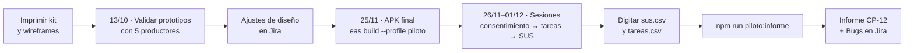

# Kit del piloto y de la validación UCD · AGRO-15 / AGRO-17

Material para ejecutar con la asociación campesina la **validación de prototipos** (AGRO-17) y el **piloto con prueba de usabilidad** (AGRO-15, caso CP-12, RNF-02). El equipo lo imprime, lo aplica en campo y carga los resultados en las planillas CSV; `npm run piloto:informe` calcula los indicadores.

## Contenido

| Documento | Uso | Momento |
|---|---|---|
| [VALIDACION_PROTOTIPOS_UCD.md](VALIDACION_PROTOTIPOS_UCD.md) | Prueba de los 5 wireframes en papel con productores (AGRO-17) | 13/10/2026 (EDT 5.4 del cronograma) |
| [PROTOCOLO.md](PROTOCOLO.md) | Diseño del piloto: participantes, sesiones, métricas, criterios de aceptación | 26/11 – 01/12/2026 |
| [GUION_TAREAS.md](GUION_TAREAS.md) | Tareas P1–P6 (productor) y C1–C6 (consumidor) con texto para leer, criterio de éxito y hoja de observación | Cada sesión |
| [CUESTIONARIO_SUS.md](CUESTIONARIO_SUS.md) | System Usability Scale en español sencillo (Brooke, 1996) | Al final de cada sesión |
| [CONSENTIMIENTO.md](CONSENTIMIENTO.md) | Consentimiento informado y autorización de datos (Ley 1581 de 2012) | Antes de empezar |
| [REGISTRO_RESULTADOS.md](REGISTRO_RESULTADOS.md) | Bitácora de sesiones, incidentes, hallazgos con severidad y disponibilidad | Durante y después |
| `plantillas/sus.csv`, `plantillas/tareas.csv` | Planillas para digitar los datos | Después de cada sesión |

## Flujo de trabajo



## Responsables (Entrega 2, matriz RACI)

| Actividad | Ejecuta | Aprueba |
|---|---|---|
| Validar prototipos de baja fidelidad (AGRO-17) | Julio Carrillo | Julio Durán |
| Piloto y prueba de usabilidad (AGRO-15) | Julio Carrillo, Julio Durán, Geron Vergara | Project Manager |
| APK y entorno de producción (AGRO-16, actividad 41) | Geron Vergara | Geron Vergara |

## Preparar el entorno del piloto

```bash
# 1. APK del piloto apuntando a la API de producción (docs/despliegue/RUNBOOK.md)
cd app && npx eas-cli build --platform android --profile piloto
# 2. Solo para la capacitación previa (NO en la base del piloto): datos de demostración
cd api && npm run sembrar -- --api https://api-pruebas.agrotech.co --confirmar
# 3. Al terminar, el informe de CP-12
cd api && npm run piloto:informe -- --sus ../docs/piloto/datos/sus.csv --tareas ../docs/piloto/datos/tareas.csv --salida ../docs/piloto/INFORME_CP12.md
```

> Los datos reales del piloto se guardan en `docs/piloto/datos/` **sin nombres ni celulares** (solo códigos P01, P02…). La tabla que relaciona códigos y personas queda en papel, en custodia del responsable del piloto.
